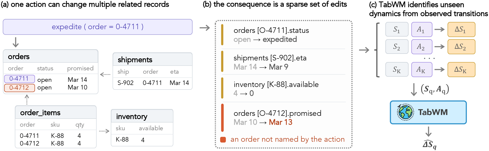

# TabWM

This is the code for *Relational Learning as World Modeling*. TabWM (Tabular World Model) predicts how an action changes a relational database, using past executions of the same system as context.

## Motivation



Relational models usually predict a target from a database state. When the database belongs to a running system, deciding what to do requires a different question: what will change if we take an action? Expediting an order, for example, can update its shipment, use up the remaining inventory, and delay another order that the action never names.

These consequences depend on rules of the system that are often not visible in the data, so the same state and action can lead to different outcomes in different systems. Past executions reveal how actions behave in the current one. TabWM is pretrained across many executable relational worlds and learns to read such executions in context. Given a few observed transitions from an unseen world, it predicts the edits caused by a new action without updating its parameters. Since the predictions are explicit edits, they can be applied and rolled forward to compare candidate actions.

## Installation

```bash
conda create -n tabwm python=3.12
conda activate tabwm
python -m pip install -e .
```

Python 3.10+ and PyTorch 2.5+ are required. Use `pip install -e ".[dev]"` to include the test dependencies.

## Model checkpoint

The released checkpoint (24.7M parameters) is available on [Hugging Face](https://huggingface.co/oooranz/TabWM) and consists of `config.json` and `model.safetensors`. It can be loaded from the Hugging Face repository identifier or a local directory:

```python
from tabwm import TabWM

model = TabWM.from_pretrained("oooranz/TabWM", device="cpu")
```

## Inference

The example samples a WorldRel world, collects `--k` observed executions as context, and prints the predicted edits for a query action as JSON:

```bash
python examples/predict.py oooranz/TabWM --world-seed 9000000 --k 16
```

## Training

Training tasks are sampled online from WorldRel, our generator of executable relational worlds. The encoder is initialized from the Relational Transformer released with PluRel. The MIT-licensed paper checkpoint and its configuration are included under `plurel/`.

```bash
python scripts/train.py --output runs --name tabwm
```

Checkpoints and training metrics are written to `runs/tabwm/`. Add `--resume` to continue from the latest checkpoint. The `--pretrained` option can select another compatible initialization directory. Run `python scripts/train.py --help` for the remaining options.

## Testing

```bash
TABWM_MODEL_PATH=/path/to/tabwm-model pytest -q
```

## Acknowledgements

The relational encoder builds on the Relational Transformer released with PluRel. Its MIT license is included in `plurel/LICENSE`.
